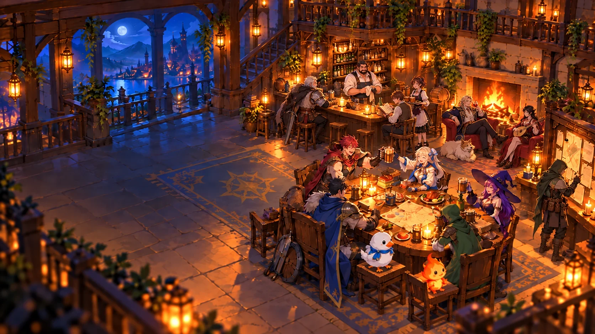
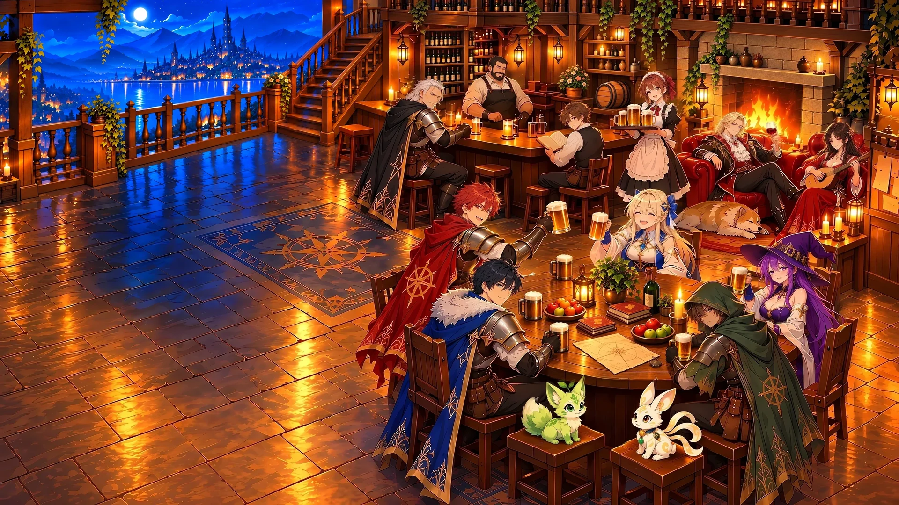

# Image Studio

**An image-editing plugin for Codex and Claude Code: fix, sharpen, or create images, change only what you name, and prove the result before calling it done.**

Image Studio has no image model of its own. Your agent's image tool (Codex `image_gen`) and local tools (ImageMagick, an upscaler) make the pixels; Image Studio tells the agent which method to use, checks the result, and remembers your approved work, your taste, and past mistakes across tasks.

| Before (1672×941, wrong pets) | After (repainted, upscaled, repaired) |
| --- | --- |
|  |  |

How this example was made: [tavern hero case](examples/image-repair/tavern-hero-case.md).

## Install

```bash
# Codex
codex plugin marketplace add hbui290/image-studio
codex plugin add image-studio@image-studio

# Claude Code
claude plugin marketplace add hbui290/image-studio
claude plugin install image-studio@image-studio
```

Start a new chat afterwards. To update: `codex plugin marketplace upgrade image-studio && codex plugin add image-studio@image-studio`, or `claude plugin marketplace update image-studio && claude plugin update image-studio@image-studio`. Do not update while a task is running.

Other agents (Cursor, OpenCode, Gemini CLI and others supported by [skills](https://github.com/vercel-labs/skills)): `npx skills add hbui290/image-studio --skill '*'`. Install every skill: the others call scripts in `image-verify`. Or clone this repository and run `python3 scripts/install.py --to <your-skills-directory>` (`--replace` to update; it deletes those skill folders first).

## Use it

Describe the task, or name the skill to be sure (`$image-studio:image-repair ...` in Codex, `/image-studio:image-repair ...` in Claude Code):

| You want to | Skill |
| --- | --- |
| Fix one or more regions (a face, a hand, a removed object, a logo) and keep the rest | `image-repair` |
| Make a new image, banner, or social post | `image-create` (`image-loop` for review-and-repair rounds) |
| Sharpen or upscale, clean cutout edges, logo to SVG, web export | `image-enhance` |
| Check an image before delivery | `image-verify` |
| Find what is wrong, or locate objects | `image-inspect` |
| Plan an edit on a numbered map | `image-edit-map` |
| Extract palette, type, and layout to JSON | `image-reverse-engineer` |
| Rebuild or remix a reference from its parts | `image-reconstruction` |
| Mix several references into directions | `image-inspiration` |

Only the skill that matches is loaded; the others cost a line each.

## How a task runs

1. **Memory:** the agent loads your taste notes, lessons from earlier tasks, and the brand kit (logo, fonts, colors).
2. **Assets and copy first:** it uses your own logo, fonts, and icons, confirms every word and number once, and settles the style (for example 2D, not a 3D render) before the first full image.
3. **Layers:** text, numbers, and logos are never drawn by the generator. `compose_layers.py` places them, and a cut-out subject, on the art, so changing a word or moving the logo takes one run, not a new generation. Text can be laid out inside a box (wrap, shrink to fit, or clip), and a PNG keeps the resolved layout in a tEXt chunk.
4. **Hunt:** a fresh reviewer agent checks the whole image once (AI slop, broken outlines, leftovers, seams, hands, your past complaints) and `map` draws every problem on one image, so you confirm them all at once.
5. **Repair in one batch:** patches for all confirmed regions are generated in parallel, resized without stretching and checked with `align-check` (checker and overlay views; `blend` refuses a patch until those views are accepted with `--accept`), then pasted through masks with `blend`, which matches each patch's color to its surroundings and reports the color difference (CIEDE2000) and seam step; `edit-check --mask` proves nothing outside each region changed and that the mask took effect, and `shape-check` proves a protected object kept its silhouette (IoU, proportions, outline).
6. **Gate:** before the agent may say "done", every problem ever reported must be re-checked on a fresh crop. A hook blocks "done" while the gate has not passed. `crop-check` confirms the focus survives 16:9, 4:5, 1:1, and 9:16 crops and that the image is twice its display size.

## Speed and tokens

- **One chat per task.** A long chat resends its whole history on every step (one measured chat sent about 227,000 tokens per step). Memory lives in the project store, lessons, and taste notes, so a new chat loses nothing. The session card says when a chat has grown too long.
- **Name the skill** when you know it, so the agent does not guess.
- **Confirm the map once** instead of reporting problems one by one.
- **Images cost the most tokens:** the main chat opens only the map, the thumbnail, and one check view; review tiles (each at most about 1024 px) are opened by the hunter agent.

## Tools

| Needed for | Tool |
| --- | --- |
| Everything that touches pixels | [ImageMagick](https://imagemagick.org/download/) 7 and Python 3.9+ with [Pillow](https://pypi.org/project/pillow/) (run scripts with [uv](https://docs.astral.sh/uv/): `uv run --with pillow --with jsonschema python3 ...`) |
| Generating or redrawing | Codex `image_gen` (Claude Code has no built-in generator; it hands back the prompt) |
| Sharpen or upscale | [Upscayl](https://github.com/upscayl/upscayl) (`upscayl-bin` and models) or [Real-ESRGAN-ncnn-vulkan](https://github.com/xinntao/Real-ESRGAN-ncnn-vulkan) |
| Cutouts, text checks, and hand boxes on macOS 14+ | Built in: `mac_vision.py` uses Apple Vision (no download; needs the Xcode command line tools for `swiftc`) |
| Optional | [rembg](https://github.com/danielgatis/rembg) (backgrounds off macOS or when edges matter: `birefnet-general-lite`), [Potrace](https://potrace.sourceforge.net) (logo to SVG), [jsonschema](https://pypi.org/project/jsonschema/) (spec checks and `image-loop`), [Codex CLI](https://github.com/openai/codex) (automated review) |

Model choice by image type, measured results, and licence notes: [enhancement recipes](plugins/image-studio/skills/image-enhance/references/recipes.md). Setup checklist: [tool readiness](plugins/image-studio/skills/image-repair/references/tool-readiness.md).

## Memory and the gate

`studio_state.py init --project PATH --brand ID` creates a `.image-studio/` folder in the project. It keeps approved files (by hash), every reported problem with a stable ID (`D1`, `D2`, ...), and decisions. Lessons and taste notes are shared by every task in `~/.image-studio/` (or `$IMAGE_STUDIO_HOME`).

Two hooks run in Codex (trust them once) and Claude Code: **SessionStart** prints a short memory card when the folder has a store, and **Stop** blocks a "done" or "xong" message while a deliverable has not passed the gate. Both stay silent without a store. Details: [project memory](plugins/image-studio/skills/image-verify/references/project-memory.md); how pass, fail, and stop are decided: [decisions](plugins/image-studio/skills/image-verify/references/decisions.md).

## Limits

- AI reviewers still miss subtle problems (overall softness, uneven outlines). The hunt is a first pass; you make the final call, and what it missed becomes a lesson.
- Upscalers sharpen detail that exists; they cannot recover a face or letter the source never had, and they garble small text.
- A flat image does not reveal its prompt, fonts, or layers.
- Pixel audits refuse 16-bit-per-channel color files (compare 8-bit copies).
- "Passed" means the stated checks passed, not that you approved it.

## Troubleshooting

- **Skills missing or doubled:** start a new chat; remove older copies installed another way (or an old `image-processing` skill).
- **`stop_provider` from `review.py`:** the Codex reviewer could not run (not signed in, no vision model, or over `--timeout`). Use the `image-reviewer` agent or `--report` instead.
- **No upscaler found:** `image-enhance` stops instead of faking it with a sharpen filter; install one from the Tools table.

## Development

```bash
uv run --with pillow --with jsonschema python3 -m unittest discover -s tests
```

Offline tests: no model calls; tests skip themselves when a dependency is missing. Changes are listed in [CHANGELOG](CHANGELOG.md).

MIT license. See [NOTICE](NOTICE) for sources.
